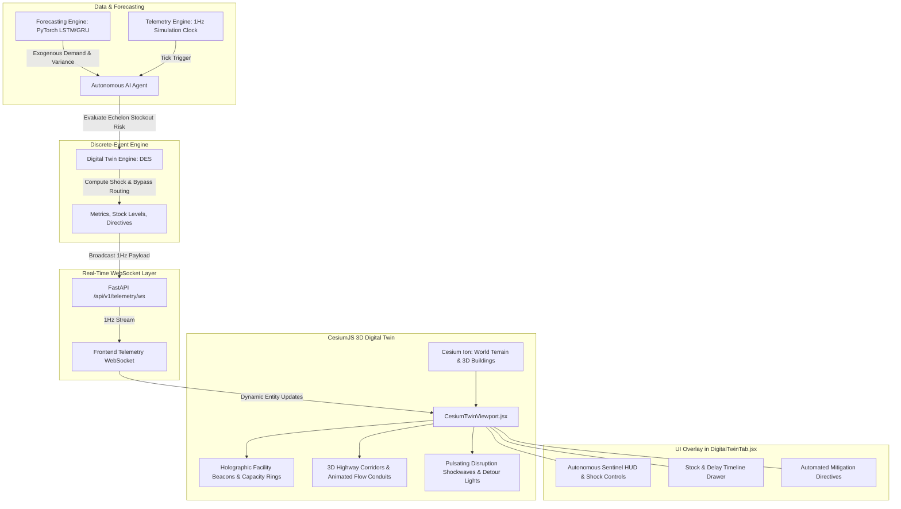

# Comprehensive Implementation Plan: 3D Digital Twin with CesiumJS & Autonomous AI

## Executive Overview

This plan details the end-to-end implementation of the **3D Digital Twin** for the **Cognitive Smart Logistics Platform**, transforming the existing discrete-event simulation ([digital_twin_engine.py](file:///c:/Users/Asus/Desktop/PBL/backend/app/engines/digital_twin_engine.py)), dynamic routing ([routing_engine.py](file:///c:/Users/Asus/Desktop/PBL/backend/app/engines/routing_engine.py)), and LSTM demand forecasting ([forecasting_engine.py](file:///c:/Users/Asus/Desktop/PBL/backend/app/engines/forecasting_engine.py)) into a **Cinematic Cyber-Geospatial 3D Operations Twin** powered by **CesiumJS**.



---

## Confirmed Architectural Decisions

| Decision Area | Selected Strategy | Rationale & Specifications |
| :--- | :--- | :--- |
| **3D Engine** | **CesiumJS** (via `vite-plugin-cesium`) | Geographically anchored real-world 3D globe with photorealistic 3D buildings, digital terrain, and high-precision WGS84 coordinate projection for the Western India corridor (JNPT, Bhiwandi, Thane, Nashik, Pune). |
| **UI Integration** | **Embedded Central Viewport in [DigitalTwinTab.jsx](file:///c:/Users/Asus/Desktop/PBL/frontend/src/components/DigitalTwinTab.jsx)** | Upgrades the current tabular/chart view into a high-tech 3D command center with floating glassmorphism overlays for shock presets, timeline metrics, and mitigation directives. |
| **Cesium Assets** | **Strict Cesium Ion Only** | Utilizes developer's `VITE_CESIUM_ION_TOKEN` configured in `.env` for full Cesium World Terrain and global photorealistic 3D building meshes. |
| **Simulation Scope** | **Macro-Facility Focused** | Prioritizes multi-echelon network nodes, supply chain links, flow volumes, and shock propagation across the corridor; vehicle volumes represented as animated 3D summary flow conduits rather than individual micro-truck meshes. |
| **AI Integration** | **Full Autonomous AI Agent** | Evaluates forecast bounds from [forecasting_engine.py](file:///c:/Users/Asus/Desktop/PBL/backend/app/engines/forecasting_engine.py) against inventory levels and automatically injects preventative mitigation scenarios onto the 3D twin without requiring manual prompting. |
| **Schedule / Loop** | **Real-Time 1Hz Tick Evaluation** | Evaluates forecast bounds and echelon risk on every 1Hz WebSocket simulation tick streamed from [telemetry_engine.py](file:///c:/Users/Asus/Desktop/PBL/backend/app/engines/telemetry_engine.py). |
| **3D Visual Styling** | **Cinematic Cyber-Geospatial Visuals** | 3D illuminated facility beacons with real-time holographic stock capacity rings, animated 3D particle flow conduits along highway corridors, pulsating disruption shockwaves, and smooth camera fly-to presets for each hub. |

---

## Phase-by-Phase Execution Plan

### Phase 1: Environment Setup & CesiumJS Vite Integration
**Goal**: Install CesiumJS, configure Vite asset handling, and establish Cesium Ion authentication.

1. **Install Dependencies in `frontend`**:
   - Install `cesium` and `vite-plugin-cesium`.
   - Update [frontend/package.json](file:///c:/Users/Asus/Desktop/PBL/frontend/package.json).
2. **Configure [frontend/vite.config.js](file:///c:/Users/Asus/Desktop/PBL/frontend/vite.config.js)**:
   - Import and integrate `cesium()` plugin.
   - Configure Cesium base URL and worker bundling so Vite can hot-reload without WebWorker asset errors.
3. **Configure Environment Variables**:
   - Ensure `VITE_CESIUM_ION_TOKEN` is loaded from root `.env` / `frontend/.env`.
   - Add verification check in the app to display a setup guide if `VITE_CESIUM_ION_TOKEN` is absent.

### Phase 2: Autonomous AI Logistics Sentinel Engine (Backend)
**Goal**: Bridge [forecasting_engine.py](file:///c:/Users/Asus/Desktop/PBL/backend/app/engines/forecasting_engine.py) and [digital_twin_engine.py](file:///c:/Users/Asus/Desktop/PBL/backend/app/engines/digital_twin_engine.py) into the 1Hz WebSocket loop in [telemetry_engine.py](file:///c:/Users/Asus/Desktop/PBL/backend/app/engines/telemetry_engine.py).

1. **Implement `AutonomousAgentEngine`** in `backend/app/engines/autonomous_agent.py`:
   - Continuous risk assessment logic:
     - Ingests SKU forecasts (7-day, 14-day) and 95% upper confidence interval bounds.
     - Compares against each echelon node's current stock, reorder point, and nominal daily inflow/outflow.
     - Computes corridor bottleneck risk scores (0–100) for links (JNPT-Bhiwandi, Bhiwandi-Thane, Kasara Ghat NH-160, Mumbai-Pune Expressway).
   - Autonomous mitigation trigger:
     - When risk score exceeds threshold (e.g. $> 70$), autonomously synthesizes a preventative mitigation directive (e.g., pre-emptive freight diversion via Malshej Ghat or rail feeder).
     - Updates simulation state with active autonomous mitigation directives.
2. **Update [telemetry_engine.py](file:///c:/Users/Asus/Desktop/PBL/backend/app/engines/telemetry_engine.py)**:
   - Integrate `AutonomousAgentEngine.evaluate_tick(sim_state)` into the 1Hz broadcast loop.
   - Include macro-corridor telemetry in every tick:
     - Node stock levels & capacity percentages (JNPT, Bhiwandi, Thane, Nashik, Pune).
     - Corridor flow vectors (throughput volume, congestion index, operational status).
     - Active shockwaves (coordinates, radius, severity) and alternative bypass paths.
     - Autonomous agent status message and current health index.
3. **Expose Autonomous Agent Endpoints in [twin.py](file:///c:/Users/Asus/Desktop/PBL/backend/app/api/v1/twin.py)**:
   - `GET /api/v1/twin/autonomous-status` to inspect current agent state and decision log.
   - `POST /api/v1/twin/autonomous-toggle` to switch between Autonomous Sentinel mode and Manual Operator mode.

### Phase 3: Cesium 3D Digital Twin Viewport Component (Frontend)
**Goal**: Create high-performance React component wrapping the CesiumJS Viewer with custom 3D cyber-geospatial graphics.

1. **Create `frontend/src/components/CesiumTwinViewport.jsx`**:
   - Initialize `Cesium.Viewer` with Cesium World Terrain and 3D Photorealistic Buildings via `VITE_CESIUM_ION_TOKEN`.
   - Disable unnecessary default widgets (timeline, animation controller, credit container styling) to create a clean, modern HUD canvas.
   - Implement **Camera Preset Manager**:
     - `CORRIDOR_OVERVIEW`: Angled bird's-eye view of Western Maharashtra (elevation ~180km, pitch -50°).
     - `JNPT_PORT`: Close-up inspection of maritime container terminals.
     - `BHIWANDI_DC`: Central distribution hub elevation.
     - `KASARA_GHAT`: Mountainous pass elevation revealing steep terrain gradients and landslide zones.
     - `NASHIK_DEPOT`: Northern agricultural transit center.
     - `PUNE_FC`: Southern automotive cluster.
2. **Holographic Facility Nodes**:
   - Add custom 3D graphic entities for all 5 default topology nodes:
     - Volumetric vertical light cylinders/beacons.
     - Dynamic 3D stock rings whose diameter/color reflects real-time stock percentage (Green $\ge 60\%$, Amber $30-59\%$, Red $< 30\%$).
     - High-visibility billboard labels displaying Node Name, Current Stock Units, and Echelon Tier.
3. **Dynamic 3D Flow Conduits (Corridors)**:
   - Render 3D polyline conduits draped over terrain along real highway corridors (NH-48, NH-160, Expressway).
   - Implement animated particle pulse shader or dynamic material moving along the line in the direction of freight flow.
   - When a corridor is disrupted, dynamically transform polyline into a pulsating hazard pattern (dashed red glow), while illuminating the alternative mitigation bypass corridor in cyan/emerald.
4. **Disruption Shockwaves**:
   - Render volumetric pulsating 3D ellipsoids/rings at the epicenters of active shocks (e.g. Kasara Ghat rockfall or Mumbai Port strike).
5. **Interactive Picking**:
   - Click listener on facilities to select nodes, trigger smooth camera glide (`flyTo`), and broadcast selection to parent state.

### Phase 4: Modernizing [DigitalTwinTab.jsx](file:///c:/Users/Asus/Desktop/PBL/frontend/src/components/DigitalTwinTab.jsx)
**Goal**: Embed the 3D Cesium Viewport as the central centerpiece with floating glassmorphism overlays.

1. **Layout Restructuring**:
   - **Central Canvas**: Full-height, responsive `CesiumTwinViewport` container.
   - **Top-Left HUD**: Autonomous AI Sentinel status card (showing real-time 1Hz risk score, active preventative measures, and mode toggle).
   - **Top-Right Quick Navigation**: 1-click camera fly-to buttons for all nodes (JNPT, Bhiwandi, Thane, Nashik, Pune, Full Corridor).
   - **Bottom-Left Drawer (Collapsible)**: Preset shock scenario selector, shock intensity slider, and mitigation toggle.
   - **Bottom-Right Drawer (Collapsible)**: Financial impact card (Baseline vs. Mitigated cost, Net savings, SLA breach count) and timeline chart (Stock / Delay hours).
   - **Right-Side Node Inspector Drawer**: Detailed telemetry and inventory echelons for the currently clicked 3D facility.
2. **Live WebSocket State Binding**:
   - Subscribe `CesiumTwinViewport` and `DigitalTwinTab` to `telemetryWS` tick events.
   - Instantly update node stock rings and corridor flow speeds without page reload.

### Phase 5: Verification & End-to-End Validation
**Goal**: Ensure zero console errors, smooth 60 FPS rendering, correct 1Hz WebSocket streaming, and automated test coverage.

1. **Frontend Build Verification**:
   - Run `npm run build` in `frontend` to verify that Cesium workers, glTF assets, and Vite plugins compile cleanly.
   - Run `npx oxlint` to ensure code quality.
2. **API & Engine Testing**:
   - Add unit/integration tests in `backend/tests/test_autonomous_twin.py` asserting:
     - Autonomous agent correctly detects demand anomalies from `forecasting_engine`.
     - 1Hz WebSocket ticks contain valid macro-corridor telemetry schemas.
     - Scenario simulations calculate valid mitigated financial metrics in $< 5.0$ seconds.
3. **Browser Validation**:
   - Launch application via `npm run dev` and backend uvicorn server.
   - Validate 3D camera navigation, node picking, autonomous AI alert generation, and visual shockwave rendering.

---

## File Modification & Creation Manifest

```text
c:\Users\Asus\Desktop\PBL/
├── .env                                       # Confirm / add VITE_CESIUM_ION_TOKEN
├── backend/
│   ├── app/
│   │   ├── engines/
│   │   │   ├── autonomous_agent.py            # [NEW] Real-time 1Hz Autonomous AI risk & mitigation engine
│   │   │   ├── digital_twin_engine.py         # [UPDATE] Macro corridor flows & bypass metadata
│   │   │   └── telemetry_engine.py            # [UPDATE] Broadcast autonomous state & macro flows in 1Hz tick
│   │   └── api/v1/
│   │       └── twin.py                        # [UPDATE] Autonomous toggle & state query endpoints
│   └── tests/
│       └── test_autonomous_twin.py            # [NEW] Integration tests for autonomous agent & twin tick
└── frontend/
    ├── package.json                           # [UPDATE] Add cesium, vite-plugin-cesium
    ├── vite.config.js                         # [UPDATE] Configure cesium plugin and assets
    └── src/
        ├── components/
        │   ├── CesiumTwinViewport.jsx         # [NEW] CesiumJS 3D cyber-geospatial twin component
        │   └── DigitalTwinTab.jsx             # [UPDATE] Embed 3D viewport with floating glassmorphism HUDs
        └── services/
            └── websocket.js                   # [UPDATE] Handle macro-corridor flow and autonomous tick events
```
