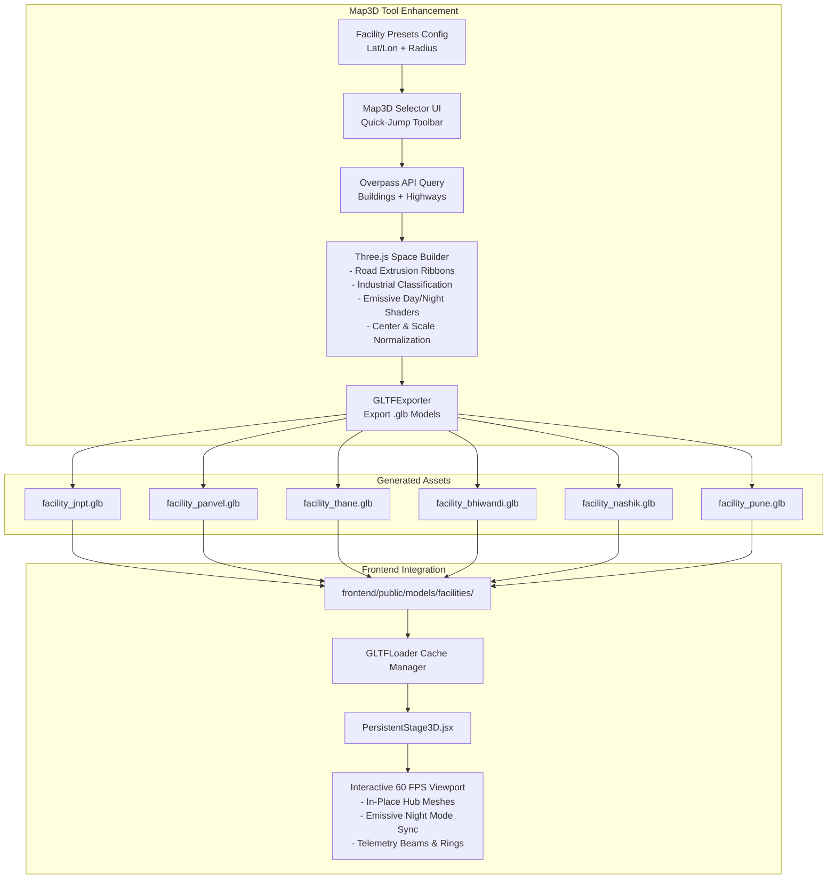

# Architectural Plan: 3D GLB Logistics Hub Models & Integration

## 1. Executive Summary

This plan outlines the end-to-end strategy to generate high-fidelity 3D models (`.glb` format) for the Western India Transport Logistics Corridor using the [`map3d`](file:///c:/Users/Asus/Desktop/PBL/map3d) tool and integrate them into the main platform's [`PersistentStage3D.jsx`](file:///c:/Users/Asus/Desktop/PBL/frontend/src/components/PersistentStage3D.jsx).

The system replaces procedural placeholder boxes at all major urban facility nodes with realistic, OpenStreetMap-derived 3D architectural digital twins featuring:
- **Physical extruded roads and docks** (rather than 1px line wireframes)
- **Logistics-differentiated materials** (metallic/slate industrial warehouses vs urban surroundings)
- **Emissive day/night materials** that illuminate during night-shift simulation modes
- **Performance optimization** (origin-centered, scale-normalized to ~8 units, merged draw calls for 60 FPS)
- **Preserved interactivity** (holographic facility beams, pulsing status rings, and selection telemetry HUDs)

---

## 2. Facility Topology & Spatial Coordinates

The project corridor spans 6 critical logistics hubs across Maharashtra, India, with the dedicated elevation pass retained at Kasara Ghat:

| Facility ID | Node Name | City | Real Coordinates (WGS84) | Stage 3D Position `[x, y, z]` | Model Output Filename |
| :--- | :--- | :--- | :--- | :--- | :--- |
| `PORT-JNPT-01` | **JNPT Port Container Terminal** | Navi Mumbai | `18.9496° N, 72.9515° E` | `[-44, 0, 32]` | `facility_jnpt.glb` |
| `DEP-PNV-01` | **Panvel Logistics Depot** | Panvel | `18.9894° N, 73.1175° E` | `[-34, 0, 24]` | `facility_panvel.glb` |
| `HUB-THN-01` | **Thane Regional Hub** | Thane | `19.2183° N, 72.9781° E` | `[-24, 0, 16]` | `facility_thane.glb` |
| `DC-BHW-01` | **Bhiwandi Central Mega DC** | Bhiwandi | `19.2967° N, 73.0631° E` | `[-14, 0, 2]` | `facility_bhiwandi.glb` |
| `DEP-NSK-01` | **Nashik Agro Depot** | Nashik | `19.9975° N, 73.7898° E` | `[42, 6.5, -48]` | `facility_nashik.glb` |
| `FC-PUN-01` | **Pune Auto Fulfillment Center** | Pune (Hinjewadi) | `18.5204° N, 73.8567° E` | `[28, 5.5, 42]` | `facility_pune.glb` |
| `PASS-KASARA-01` | **Kasara Ghat Mountain Pass** | Igatpuri / Ghats | `19.6967° N, 73.5611° E` | `[14, 9.5, -24]` | *(Procedural Topo Mesh)* |

---

## 3. Architecture & Data Flow

---

## 4. Phase-by-Phase Implementation Plan

### Phase 1: `map3d` Enhancement & Logistics Pre-sets
1. **Add Preset Definitions Module** (`map3d/src/constants/facilityPresets.ts`):
   - Define exact center coordinates, bounding box delta (`~0.008` deg / ~900m footprint), and facility metadata for all 6 hubs.
2. **Default Map Center to Western India Corridor** in [`SelectMap.tsx`](file:///c:/Users/Asus/Desktop/PBL/map3d/src/components/map/SelectMap.tsx):
   - Update default Leaflet view from NYC `[40.8, -73.95]` to Maharashtra `[19.15, 73.05]`, zoom level 10.
3. **Add 1-Click Facility Preset Selector Bar** in [`App.tsx`](file:///c:/Users/Asus/Desktop/PBL/map3d/src/ui/App.tsx):
   - Quick navigation buttons: `[JNPT Port]`, `[Panvel]`, `[Thane]`, `[Bhiwandi]`, `[Nashik]`, `[Pune]`.
   - Selecting a preset automatically frames the bounding box, sets the area in `areaStore`, and enables immediate 3D generation.

### Phase 2: Logistics 3D Pipeline & Material Upgrades (`map3d/src/three/`)
1. **Mesh Extrusion for Highways & Roads**:
   - Replace standard 1px `Line` objects in [`Space.tsx`](file:///c:/Users/Asus/Desktop/PBL/map3d/src/three/Space.tsx) with extruded quad ribbons (`BufferGeometry` or `TubeGeometry`) so roads export as valid solid 3D surfaces in the `.glb`.
2. **Logistics Semantic Material Classification**:
   - Inspect OSM tags (`building: industrial`, `warehouse`, `commercial`, `port`, `storage`).
   - Industrial/Warehouses: Sleek graphite/steel metallic material with dock accents.
   - Surrounding buildings: Muted architectural blocks.
   - Add asphalt ground slab matching the bounding area.
3. **Emissive Day/Night Lighting Support**:
   - Add window slit / facade emissive channels (`emissive: #38bdf8`, `emissiveIntensity: 0.8`) and road centerline luminescence (`#06b6d4`).
   - Materials export with standard PBR emissive properties readable by Three.js `MeshStandardMaterial`.
4. **Origin Centering & Scale Normalization**:
   - Center geometry around centroid `(0, 0, 0)`.
   - Scale overall bounding radius to ~8.0 world units to match `PersistentStage3D` node dimensions.
   - Name exported files consistently: `facility_<hubId>.glb`.

### Phase 3: Model Export & Asset Delivery
1. Generate and export all 6 models from `map3d`:
   - `facility_jnpt.glb` (JNPT Port Terminal)
   - `facility_panvel.glb` (Panvel Logistics Depot)
   - `facility_thane.glb` (Thane Regional Hub)
   - `facility_bhiwandi.glb` (Bhiwandi Central DC)
   - `facility_nashik.glb` (Nashik Agro Depot)
   - `facility_pune.glb` (Pune Auto Fulfillment Center)
2. Place all generated assets into `frontend/public/models/facilities/`.

### Phase 4: Frontend Stage Integration (`PersistentStage3D.jsx`)
1. **Create Model Loader Utility** (`frontend/src/utils/modelLoader.js`):
   - Singleton `GLTFLoader` with indexed memory caching and clone-on-instantiate to eliminate redundant network requests.
2. **Update Facility Node Builder** in [`proceduralWorld.js`](file:///c:/Users/Asus/Desktop/PBL/frontend/src/components/3d/proceduralWorld.js):
   - Asynchronously load corresponding `.glb` for each facility node.
   - Smoothly fade in loaded GLB and replace placeholder box mesh.
   - Retain procedural fallback if loading fails or while model is streaming.
3. **Maintain Visual Interactivity & Telemetry**:
   - Attach holographic vertical light beam (`CylinderGeometry`) at hub center.
   - Attach pulsing ground status ring (`RingGeometry`).
   - Ensure mesh raycasting and click handlers link to `selectFacility(node.id)`.
4. **Night Mode Emissive Synchronization**:
   - In `PersistentStage3D.jsx`, when the simulation clock enters night hours (or night toggle is activated), adjust model material `emissiveIntensity` to illuminate hub windows and highway corridors.

---

## 5. Verification & Acceptance Criteria

1. **Map3D Functionality**:
   - Opening `map3d` shows Western India by default.
   - Clicking any of the 6 facility preset buttons instantly positions the bounding box around the real GPS coordinates.
   - "Next Step" queries Overpass and renders 3D buildings, extruded road ribbons, and emissive materials.
   - "Export GLB" downloads clean, self-contained binary `.glb` files (< 4 MB each).
2. **PersistentStage3D Integration**:
   - Main 3D stage displays real 3D architectural hubs for JNPT, Panvel, Thane, Bhiwandi, Nashik, and Pune.
   - Kasara Ghat continues to render its steep elevation topography pass.
   - Camera views (`CAMERA_VIEWS.JNPT_PORT`, `BHIWANDI_DC`, etc.) zoom in smoothly to detailed hub geometry.
   - 60 FPS performance maintained with no WebGL context loss or memory leaks.
