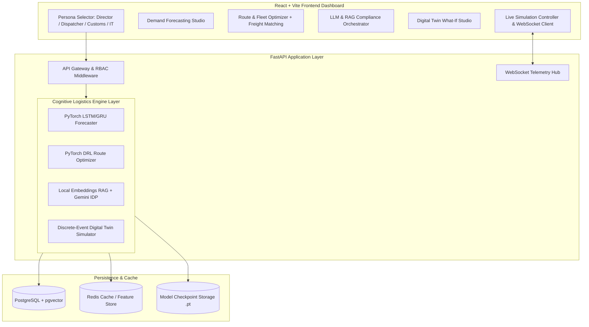

# Cognitive Smart Logistics Platform — Architectural Specification & Implementation Plan

> [!IMPORTANT]
> **Workspace Safety Guarantee**: All code, configuration, models, databases, and dependencies reside strictly inside `c:\Users\Asus\Desktop\PBL`. No Git operations will be performed against any outer repository.

---

## 1. Architectural Summary & Design Decisions

Following our `/grill-me` alignment session, the system architecture and operational boundaries are established as follows:



### Key Aligned Decisions

| Domain | Selected Decision | Operational Characteristic |
| :--- | :--- | :--- |
| **Primary Scope** | Full-Stack End-to-End Interactive Prototype | Demonstrates all 4 core engines + Freight matching with live interactive map and WebSocket playback. |
| **Frontend Stack** | Vite + React + Tailwind CSS | Fast responsive SPA with Leaflet.js geospatial mapping, Chart.js analytics, and Lucide icons. |
| **Forecasting Engine** | PyTorch LSTM / GRU | Multi-horizon demand sequence prediction with 95% confidence intervals and exogenous weather/promo feeds. |
| **Routing Engine** | PyTorch Deep Reinforcement Learning (DRL) | Dynamic VRP agent with live traffic weight graph and continuous re-routing capabilities. |
| **Compliance & IDP** | Hybrid RAG (Local Embeddings + Gemini 2.5) | Local PyTorch/HuggingFace transformer embeddings for sub-second HS code retrieval; Google Gemini for OCR/IDP extraction and trade rule discrepancy verification. |
| **Digital Twin Engine** | Discrete-Event Simulation (DES) | "What-If" scenario studio with side-by-side baseline vs. mitigated metrics (Risk index, SLA delay hours, holding cost, CO2 impact). |
| **Freight Matching** | Integrated Fleet Load-Balancer | Embedded directly into the Route Optimization view for carrier capacity and return backhaul pairing. |
| **Live Telemetry** | WebSocket Playback Controller | Interactive Play/Pause/Speed bar with live GPS coordinates, vehicle sensor readings, and disruption injection. |
| **User Personas** | Top-Bar Persona Switcher | Immediate role switching (Supply Chain Director, Dispatcher, Customs Officer, IT Admin) with dynamic UI filtering. |
| **Data Layer** | Docker PostgreSQL (pgvector) + Redis | Clean local `docker-compose.yml` in `c:\Users\Asus\Desktop\PBL` with automated migration, seeders, and memory fallback. |

---

## 2. Directory & Component Structure

```
c:\Users\Asus\Desktop\PBL\
├── docker-compose.yml              # PostgreSQL + pgvector (5432) & Redis (6379)
├── .env                            # GEMINI_API_KEY and service configurations
├── README.md                       # Complete setup and execution guide
│
├── backend\                        # Python FastAPI Backend
│   ├── requirements.txt            # Python dependencies (torch, fastapi, uvicorn, transformers, etc.)
│   ├── app\
│   │   ├── main.py                 # FastAPI application entry point, CORS, WebSockets
│   │   ├── config.py               # Settings and environment loader
│   │   ├── api\
│   │   │   ├── v1\
│   │   │   │   ├── forecasting.py  # /api/v1/forecasting/predict
│   │   │   │   ├── routing.py      # /api/v1/routing/optimize & freight matching
│   │   │   │   ├── compliance.py   # /api/v1/compliance/parse-doc & hs-classify
│   │   │   │   ├── twin.py         # /api/v1/twin/simulate-scenario
│   │   │   │   └── telemetry.py    # /api/v1/telemetry/ingress & WebSocket streams
│   │   ├── core\
│   │   │   ├── rbac.py             # Role-based access control & persona profiles
│   │   │   └── gemini_client.py    # Google Gemini GenAI SDK wrapper
│   │   ├── engines\
│   │   │   ├── forecasting_engine.py # PyTorch LSTM/GRU sequence predictor
│   │   │   ├── routing_engine.py     # PyTorch DRL / VRP solver
│   │   │   ├── rag_engine.py         # Local transformer embeddings + HS code search
│   │   │   └── digital_twin_engine.py# Discrete-event simulation network
│   │   ├── db\
│   │   │   ├── database.py         # SQLAlchemy session & fallback handling
│   │   │   ├── models.py           # Relational & vector schemas
│   │   │   └── seed_data.py        # Western India corridor (Nashik, Mumbai, Thane, Pune, JNPT)
│   │   └── checkpoints\            # Saved PyTorch .pt model weights
│   └── train_models.py             # Standalone CPU-optimized PyTorch training script
│
└── frontend\                       # Vite + React Dashboard
    ├── package.json
    ├── vite.config.js
    ├── tailwind.config.js
    ├── index.html
    └── src\
        ├── main.jsx
        ├── App.jsx                 # App layout, top bar with Persona Switcher
        ├── components\
        │   ├── Navbar.jsx          # Header, persona indicator, simulation status
        │   ├── SimulationBar.jsx   # Play, Pause, Speed 1x-5x, Disruption Injector
        │   ├── MapView.jsx         # Leaflet.js interactive corridor map
        │   ├── ForecastingTab.jsx  # Demand curves, confidence intervals, SKU selectors
        │   ├── RoutingTab.jsx      # Route waypoints, vehicle telemetry, freight matching
        │   ├── ComplianceTab.jsx   # Document parser (BoL/Invoice), HS lookup, flags
        │   └── DigitalTwinTab.jsx  # Scenario studio, network graph, comparative metrics
        ├── services\
        │   ├── api.js              # Axios / Fetch client for REST endpoints
        │   └── websocket.js        # Real-time telemetry WebSocket connection
        └── data\
            └── sampleDocuments.js  # Pre-loaded BoL and Commercial Invoices for 1-click test
```

---

## 3. Implementation Phases

### Phase 1: Environment & Persistence Setup
- Create `docker-compose.yml` for PostgreSQL 17 (pgvector) and Redis.
- Setup `backend/requirements.txt` and verify dependencies.
- Build database schemas and seeders for the Mumbai–JNPT–Thane–Nashik corridor.

### Phase 2: Cognitive AI & Simulation Engines
- Implement PyTorch LSTM/GRU forecasting model in `backend/app/engines/forecasting_engine.py` with multi-step prediction and safety stock estimation.
- Implement PyTorch DRL / Graph routing solver in `backend/app/engines/routing_engine.py` with dynamic congestion edge penalties and freight load-balancer.
- Implement Local Embeddings RAG in `backend/app/engines/rag_engine.py` with the Harmonized System (HS) codebook, coupled with `gemini_client.py` for IDP document extraction.
- Implement Discrete-Event Digital Twin Simulator in `backend/app/engines/digital_twin_engine.py` supporting port strikes, weather shocks, and road closures.
- Implement `train_models.py` to generate compact `.pt` checkpoints.

### Phase 3: FastAPI Backend & Streaming Gateway
- Implement all endpoints strictly matching [smart_logistics_data.md](file:///c:/Users/Asus/Desktop/PBL/smart_logistics_data.md):
  - `POST /api/v1/forecasting/predict`
  - `POST /api/v1/routing/optimize`
  - `POST /api/v1/compliance/parse-doc`
  - `POST /api/v1/compliance/hs-classify`
  - `POST /api/v1/twin/simulate-scenario`
  - `GET /ws/telemetry` (WebSocket live telemetry & vehicle movement stream)
- Add persona-based RBAC middleware and health endpoints.

### Phase 4: Vite + React Frontend Dashboard
- Initialize Vite React project with Tailwind CSS, Lucide icons, Leaflet.js, and Chart.js.
- Build high-end dark-themed UI with glassmorphic cards, responsive panels, and top-bar Persona Switcher.
- Implement the 4 core views:
  1. **Demand Forecasting**: SKU selector, 14-day horizon chart, 95% confidence intervals, safety stock recommendations.
  2. **Route Optimization & Freight Matcher**: Interactive Leaflet map, truck telemetry status, live route recalculation, backhaul matching card.
  3. **Compliance & IDP**: 1-click sample document loader + PDF/image uploader, structured JSON viewer, HS code classification with similarity scores, and discrepancy flags.
  4. **Digital Twin Scenario Studio**: Disruption stress-testing slider (Port strike, Monsoon shock, Highway outage), comparative baseline vs. mitigated metrics.
  5. **Global Simulation Bar**: Play/Pause/Speed controls, real-time vehicle GPS streaming via WebSocket.

### Phase 5: End-to-End Verification & Documentation
- Test full flow: train models -> start backend -> launch frontend -> execute each module and scenario.
- Provide comprehensive run instructions in `README.md`.
